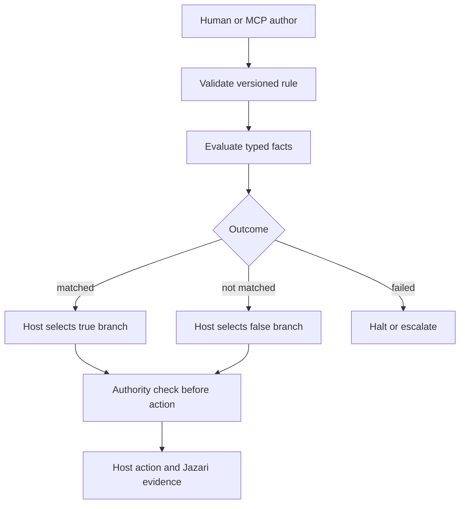

# Declarative predicates (proposal)

Refs #1. This is a design proposal, not a shipped API.

## Boundary
Predicate evaluates typed facts; Permissify authorizes; Jazari retains procedure state and evidence; host executes actions. No arbitrary Ruby from runtime authors, no AASM.

## Candidate contract
`{"schema":"predicate/v1","condition":{"field":"working_days","operator":"gt","value":10}}`

Closed schema; allowlisted typed facts and operators; bounded nesting and size; reject unknown keys, operators and type mismatches. No eval, arbitrary dispatch or implicit coercion. Facts are supplied by the host, not fetched by rules. Validate and simulate without side effects. Structured result: matched, not_matched, failed; reason and checks. Pin definition version and facts for replay; host owns persistence.

## Compatibility and hardening
Audit current Core and DSL on this branch. Reproduce missing/error false collapse, raw nonboolean results, cached errors, stale external facts, and nested mutex calls. Preserve legacy trusted DSL behavior unless separately versioned. Prefer uncached declarative evaluation initially; test concurrency and tenant isolation before enabling cache.

## Acceptance fixtures
- 12 working days: matched; 10: not_matched.
- Missing working_days, string instead of number, unknown operator: failed, never false branch.
- Unknown keys and oversized trees rejected at validation.
- Nested AND/OR/NOT deterministic; define short-circuit and failure semantics before implementation.
- Same fixtures usable for future browser parity; server authoritative.
- Legacy suite passes; new tests reproduce and resolve identified risks.

## Integration
Kuickr intake supplies validated facts; manager approval and HR routing are synthetic examples only. Permissify FactSource integration optional; no permission grants from business rules. Jazari is not an action execution framework. Related: https://github.com/Intellectaco/kuickr.co/issues/460.

## Non-goals
No new workflow engine, database schema, external dependency or executable user Ruby. Implementation follows contract review.
